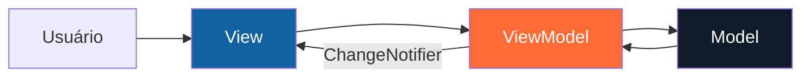

<div align="center">

# ⚡ RicardoELetro

### Tecnologia que combina com o seu mundo.

Um catálogo de produtos moderno, responsivo e desenvolvido em Flutter com arquitetura MVVM.


</div>

---

## 📱 Sobre o projeto

O **RicardoELetro** é um aplicativo de catálogo de produtos criado para a atividade de Programação Avançada. O usuário pode visualizar os itens disponíveis, pesquisar por nome, filtrar por categoria, adicionar produtos ao carrinho e cadastrar novos produtos sem perder os que já existem.

Além dos requisitos obrigatórios, o projeto recebeu identidade visual própria, validação de formulário, contador do carrinho e uma separação de responsabilidades baseada em **MVVM**.

## ✨ Destaques

| Recurso | Descrição |
|---|---|
| 🛍️ Catálogo dinâmico | Produtos renderizados com `List<Product>` e `ListView.builder` |
| 🔎 Busca inteligente | Pesquisa pelo nome do produto ou pela categoria |
| 🧩 Filtros rápidos | Categorias exibidas em chips horizontais |
| 🎨 Ícones dinâmicos | Cada categoria possui uma cor e um ícone correspondente |
| ➕ Cadastro completo | Nome, preço e categoria com validação antes de salvar |
| 🛒 Carrinho interativo | Contador visual e confirmação com `SnackBar` |
| 📐 Interface responsiva | Componentes adaptados ao espaço disponível |
| 🧠 Arquitetura MVVM | Dados, regras de negócio e interface organizados em camadas |

## ✅ Requisitos da atividade

- [x] Desenvolvido em Flutter.
- [x] Catálogo armazenado em uma `List<Product>`.
- [x] Produtos exibidos com `ListView.builder`.
- [x] Cada produto possui nome, preço e categoria.
- [x] Cada item é apresentado em um `Card`.
- [x] O card contém ícone, nome, preço e botão **Comprar**.
- [x] A tela principal possui um `FloatingActionButton`.
- [x] O botão direciona para a tela **Cadastrar produto**.
- [x] O cadastro solicita nome e preço.
- [x] A categoria é selecionada com `DropdownButtonFormField`.
- [x] O novo produto retorna para a tela principal.
- [x] Os produtos existentes são preservados após um cadastro.
- [x] O ícone é definido de acordo com a categoria.
- [x] Um `SnackBar` confirma a adição ao carrinho.

## 🧱 Arquitetura MVVM

O projeto utiliza **Model–View–ViewModel** para manter a interface desacoplada das regras de negócio.



| Camada | Responsabilidade | Principais arquivos |
|---|---|---|
| **Model** | Representa os dados e categorias do catálogo | `product.dart`, `product_category.dart` |
| **View** | Exibe telas, cards, formulários e interações | `catalog_page.dart`, `product_form_page.dart` |
| **ViewModel** | Controla estado, filtros, cadastro e carrinho | `catalog_view_model.dart`, `product_form_view_model.dart` |
| **Core** | Centraliza tema, cores e formatação monetária | `app_theme.dart`, `currency_formatter.dart` |

As `ViewModels` utilizam `ChangeNotifier`, enquanto as telas escutam as mudanças por meio de `AnimatedBuilder`.

## 📂 Estrutura do projeto

```text
lib/
├── main.dart
├── app.dart
│
├── core/
│   ├── app_theme.dart
│   └── currency_formatter.dart
│
├── models/
│   ├── product.dart
│   └── product_category.dart
│
├── viewmodels/
│   ├── catalog_view_model.dart
│   └── product_form_view_model.dart
│
└── views/
    ├── catalog_page.dart
    ├── category_presentation.dart
    ├── product_form_page.dart
    └── widgets/
        ├── brand_logo.dart
        ├── cart_button.dart
        └── product_card.dart
```

## 🔄 Fluxo de cadastro

1. O usuário toca em **Novo produto**.
2. O aplicativo abre a tela **Cadastrar produto**.
3. O usuário informa nome, preço e categoria.
4. A `ProductFormViewModel` valida os dados.
5. Um novo objeto `Product` é criado.
6. O produto retorna para o catálogo pelo `Navigator`.
7. A `CatalogViewModel` insere o item no início da lista.
8. A interface é atualizada sem remover os produtos existentes.

## 🧰 Tecnologias utilizadas

- **Flutter** e **Dart**;
- Material Design 3;
- arquitetura MVVM;
- `ChangeNotifier` e `AnimatedBuilder` para gerenciamento de estado;
- `Navigator` e `MaterialPageRoute` para navegação;
- testes com `flutter_test`;
- Gradle para compilação Android.

O projeto não depende de bibliotecas externas para o gerenciamento de estado.

## 🚀 Como executar

### Pré-requisitos

- Flutter SDK instalado;
- Android Studio ou Visual Studio Code;
- Android SDK configurado;
- emulador Android ou dispositivo físico conectado.

Confirme se o ambiente está configurado:

```bash
flutter doctor
```

Na pasta do projeto, instale as dependências:

```bash
flutter pub get
```

Confira os dispositivos disponíveis:

```bash
flutter devices
```

Execute o aplicativo:

```bash
flutter run
```

## 📦 Gerar o APK

Para gerar uma versão Android de depuração:

```bash
flutter build apk --debug
```

O APK será criado em:

```text
build/app/outputs/flutter-apk/app-debug.apk
```

Para gerar uma versão de entrega otimizada:

```bash
flutter build apk --release
```

## 🧪 Testes e qualidade

Execute os testes automatizados:

```bash
flutter test
```

Execute a análise estática do código:

```bash
flutter analyze
```

Os testes verificam:

- renderização do catálogo inicial;
- funcionamento do botão Comprar;
- exibição do `SnackBar`;
- atualização do contador do carrinho;
- cadastro de um novo produto;
- preservação dos produtos anteriores;
- busca e filtragem da lista.

## 🎨 Identidade visual

A interface combina azul, laranja e tons neutros para transmitir tecnologia e energia:

| Cor | Hexadecimal | Aplicação |
|---|---|---|
| Azul principal | `#1261A0` | Cabeçalhos, preços e filtros |
| Azul-marinho | `#0D1B2A` | Fundo de destaque e `SnackBar` |
| Laranja elétrico | `#FF6B35` | Marca, botões e ações principais |
| Branco quente | `#F7F8FA` | Fundo geral da aplicação |

## ℹ️ Observação

O catálogo é mantido em memória durante a execução. Portanto, produtos cadastrados permanecem disponíveis enquanto o aplicativo estiver aberto, mas são restaurados para a lista inicial após o aplicativo ser encerrado completamente. Persistência local ou banco de dados não fazem parte dos requisitos desta atividade.

---

<div align="center">

Desenvolvido com 💙, Flutter e uma boa dose de criatividade.

**RicardoELetro — conectando você à tecnologia.** ⚡

</div>
